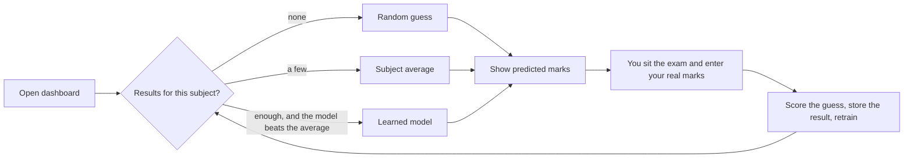

# SubjectScore AI

A small machine-learning project that predicts your marks for each subject, then learns from the real marks you enter so its next predictions are better.

It starts with no data and makes random guesses. Every time you enter real results it scores its own guesses with RMSE, retrains automatically, and switches to better predictors as evidence builds up.

**Stack:** Python, scikit-learn, Flask, HTML, Tailwind CSS, TypeScript, Chart.js

---

## Contents

- [How it works](#how-it-works)
- [Approach](#approach)
- [Accuracy and evaluation](#accuracy-and-evaluation)
- [Getting started](#getting-started)
- [Using the dashboard](#using-the-dashboard)
- [Limitations](#limitations)
- [Ideas for next steps](#ideas-for-next-steps)

---

## How it works



1. The dashboard shows a predicted mark for the next exam in every subject.
2. After the exam you type your real marks and click **Save real marks and retrain**.
3. The backend compares each real mark with the prediction you saw, logs the error, adds the result to `data.csv` and retrains the model.
4. The page refreshes with new predictions from the retrained model.

## Approach

### Problem framing

The task is to predict the **next exam mark in a subject from that subject's own history**. Marks are converted to percentages (`actual_marks / max_marks * 100`) so subjects with different maximum marks can be learned together, and the prediction is converted back to marks for display.

### Features

For each exam the model only sees what was known *before* it:

| Feature | Meaning |
| --- | --- |
| `prev_pct` | percentage scored in the previous exam of that subject |
| `avg_pct` | average percentage over all earlier exams of that subject |
| `n` | how many exams of that subject came before |

The first exam in each subject has no history, so it is not used as a training row.

### Predictors

| Stage | When it is used | Prediction |
| --- | --- | --- |
| Random guess | the subject has no results yet | a random value between 40% and 90% of the maximum marks. It is seeded by subject and data size, so it stays the same until new data arrives |
| Subject average | the subject has results, but the model is not trained or does not beat the average | the average percentage so far |
| Learned model | there is enough data, and the model beats the average on unseen results | linear regression or random forest, whichever scored the lower RMSE |

Both candidate models come from scikit-learn: `LinearRegression` and `RandomForestRegressor` (200 trees, `min_samples_leaf=2`, `random_state=42`).

### Self-training

There is no manual training step. The model is trained when the server starts and retrained every time results are saved. If the learned model stops beating the plain average after new data arrives, the app falls back to the average automatically.

## Accuracy and evaluation

### Metric: RMSE

Accuracy is measured with root mean squared error, in **marks**:

```
RMSE = sqrt( mean( (predicted_marks - actual_marks)^2 ) )
```

RMSE is in the same units as the marks, so "RMSE 5" means a typical miss of about 5 marks. It squares each error before averaging, so one large miss counts for more than several small ones. Lower is better.

Because the error is measured in marks, a miss on a 100-mark paper counts for more than the same percentage miss on a 50-mark paper.

### Offline evaluation on unseen exams

Marks are a time series, so a random train/test split would let the model learn from exams that happened after the ones it is tested on. Instead the evaluation is chronological:

- exams with a low `n` (earlier ones) are used to **train**
- exams with a high `n` (later ones) are used to **test**
- the split point is half of the largest `n`
- evaluation only runs with at least 5 training rows and 3 test rows. Before that the app does not claim an RMSE

Each candidate model is trained on the early exams and scored on the later ones it never saw. The best candidate is compared against a **baseline** that simply predicts the subject's average so far. The learned model is only used if its RMSE is lower than the baseline's. The model that is deployed is then refit on all exams that have history, so it uses slightly more data than the one that was scored.

### Live accuracy

Every prediction you saw before entering the real marks is stored in `backend/predictions_log.csv` with the actual result. The dashboard shows the RMSE of those predictions. It is the most honest number because each prediction was made before the result was known. It includes the early random guesses, so it starts high and should come down as the model learns. With only a few results it can still move up and down.

### Example results on the sample data

`backend/sample_data.csv` is **made-up** data: 5 subjects, 7 exams each, 35 results, with a gentle upward trend plus noise. On it, `python train.py` gives:

| Predictor | RMSE on unseen exams (15 test rows) |
| --- | --- |
| Subject average (baseline) | 6.89 marks |
| Linear regression | 8.83 marks |
| Random forest | **4.73 marks** (selected) |

These numbers describe the sample data only and say nothing about real exam results. Your own RMSE will depend on how consistent your marks are and how many results you have. With a few dozen results, treat the model as an experiment: if its RMSE is not clearly below the baseline's, trust the average instead.

## Getting started

Requirements: Python 3.9+, Node.js (only to compile the TypeScript).

```bash
pip install flask scikit-learn pandas joblib

# 1. Set your subjects and their maximum marks in SUBJECTS (backend/train.py)

# 2. Compile the frontend (frontend/app.js is already included; re-run after editing app.ts)
cd frontend
npx -p typescript tsc app.ts --target es2020 --lib es2020,dom --strict
cd ..

# 3. Run the server
cd backend
python app.py
```

Open http://127.0.0.1:5000.

To see the learned model working without entering results by hand, copy the made-up data over your data file and restart:

```bash
cp backend/sample_data.csv backend/data.csv
```

Tailwind CSS and Chart.js load from CDNs, so the dashboard needs an internet connection.

## Using the dashboard

- **The accuracy summary** at the top says how far off the model is on exams it has not seen, compared with simply guessing your average, and shows the live RMSE of the guesses you saw before each exam.
- **Next exams** has one line per subject: the model's guess circled in yellow, where the guess came from (random guess, subject average or learned model), a box for your real mark and the maximum marks. Changing the maximum rescales the guess.
- **Save real marks and retrain** stores the real marks, scores the earlier guesses and retrains. Leave a subject blank to skip it.
- **Predicted vs real** plots the exams the model was tested on. A dot on the dashed line was predicted exactly. It appears once there is enough data to test on.
- **How your last guesses did** appears after each save and shows how far off each guess was.

## Tutor chat

The Tutor page (`/tutor.html`) is a study tutor that explains topics, answers doubts and quizzes you. It calls **your own AI API** through one small file, `backend/llm.py`, which uses the OpenAI chat-completions format. Google's Gemini API supports that format, and so do many other providers and local servers.

Create a file named `.env` in the `backend` folder with these three lines, then start the server:

```
LLM_API_KEY=your-key
LLM_MODEL=gemini-3.5-flash
LLM_BASE_URL=https://generativelanguage.googleapis.com/v1beta/openai
```

- `LLM_MODEL` is required, and Google changes model names over time. Use a current Flash model from Google's models page (`gemini-3.5-flash` was listed when this was written). Avoid the 2.x models, which are being retired.
- `.env` is listed in `.gitignore`, so your key stays off GitHub. Never put the key in the code.
- Variables set in the terminal take priority over `.env`.
- For another provider, change `LLM_BASE_URL` and `LLM_MODEL`. `LLM_BASE_URL` defaults to Gemini's address, so you can leave it out for Gemini, and `LLM_API_KEY` can be left out for a local server that needs no key.
- If your API uses a different format, change the `chat()` function in `llm.py`. Nothing else needs to change.
- Replies show Markdown and maths. The tutor writes maths in LaTeX, and you can too: type `$x^2 + 1$` inline or `$$...$$` for a displayed equation. Rendering uses KaTeX, marked and DOMPurify from CDNs, so the page needs internet.
- Your chats appear in a sidebar and are saved in your browser (localStorage) on this computer only. Clearing your browser data deletes them. The server does not store conversations.
- When you pick a subject, the tutor is told your last few results in it so it can pitch its explanations. Your messages and those results are sent to your API provider.

## Limitations

- **Little data.** A few dozen results is a small sample, so predictions are noisy and the RMSE estimate itself is uncertain.
- **Marks only.** The model sees past marks and nothing about the exam itself, such as difficulty, topics or how much you studied.
- **Order matters.** Rows in `data.csv` must be oldest first within each subject, because the features rely on that order.
- **Random start.** The first guess for a subject is a coin toss between 40% and 90%. It is a placeholder, not a prediction.
- **Single user, local use.** There is no authentication or database. It is built to run on your own machine.

## Ideas for next steps

- Add optional inputs such as preparation hours or practice-test scores, and let the model use them when they are provided.
- Add more history features, such as the average of the last 3 exams or the recent trend.
- Plot the error of each checked prediction over time to show the model improving.
- Add a form for new subjects instead of editing `SUBJECTS`.